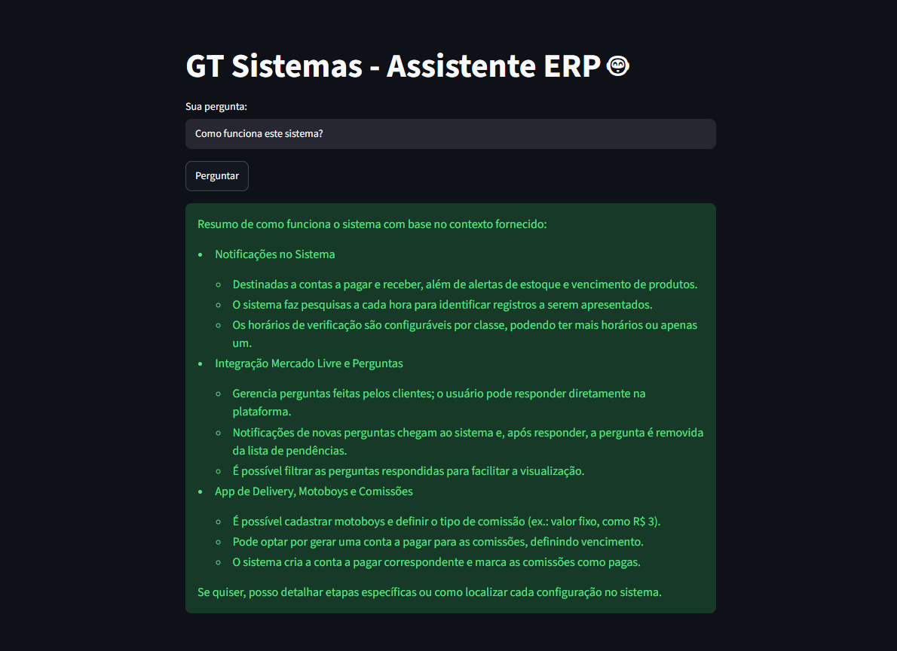

# GT Sistemas — AI Support Assistant

RAG-based AI assistant that answers questions about the GT Sistemas ERP using retrieval, LLM reranking, and grounded response generation.

Built to help the sales team learn the ERP quickly and to cut support response time, keeping every answer grounded in real documentation and troubleshooting cases.

**[Live Demo](https://gt-sistemas-rag.streamlit.app/)** · **[Repository](https://github.com/Samuel-Drei/rag-pipeline)**

> The demo may take ~30s to wake up if it has been idle.



---

## Usage

In use at GT Sistemas since **June 2026**, daily by **4+ professionals**, mainly the sales team.

| Before | After |
|---|---|
| 30–45 min waiting for a support answer | **1–2 min** |

- 💬 **~560 questions** answered
- 💸 **~$0.001–0.002** per question
- 📚 Knowledge base: **97 tutorial videos** + troubleshooting knowledge from an existing support agent used in client implementations

---

## Results

The pipeline was optimized through controlled evaluation using a fixed benchmark instead of subjective testing.

| Metric | v1.0 | v2.0 | Result |
|---|---:|---:|---:|
| **Accuracy** | 96% (24/25) | 88% (22/25) | -8 pp |
| **Average latency** | 15.8s | **5.2s** | **67% lower** (3× faster) |
| **Maximum latency** | 25.0s | **10.6s** | **58% lower** |
| **Token usage** | 100% | **33%** | **67% lower** |
| **Latency standard deviation** | 4.47s | **2.46s** | **45% lower** |

The final version deliberately trades some accuracy for significantly lower latency and token cost. For a support assistant used repeatedly throughout the day, the ~5-second response time was considered a better operational trade-off.

---

## Why this project?

Traditional LLM applications can answer questions fluently without actually grounding their responses in the system's documentation.

This project explores a more controlled approach:

**retrieve relevant knowledge → rerank candidates → generate an answer using only the retrieved context → evaluate the result**

The knowledge base combines:

- **97 GT Sistemas tutorial videos** converted into searchable documentation.
- **Troubleshooting knowledge** from an existing support agent, containing ERP errors, root causes, and resolution procedures.

This allows the assistant to answer both:

> "How do I do X?"

and:

> "Why is X failing and how do I fix it?"

---

## Architecture

```text
                    ┌──────────────────┐
                    │  Knowledge Base  │
                    └────────┬─────────┘
                             │
                             ▼
                       ┌──────────┐
                       │  Indexer │
                       └────┬─────┘
                            │
                            ▼
                       ┌──────────┐
                       │ LanceDB  │
                       └────┬─────┘
                            ▲
                            │
User ──► Retriever ──► Reranker
              │
              ▼
       Response Generator
              │
              ▼
            Answer

Evaluation runs independently against a fixed
question/answer benchmark.
```

### Pipeline

1. **Indexer** — splits the knowledge base into contextual chunks using Markdown heading hierarchy.
2. **Datastore** — stores embeddings and performs similarity search using LanceDB.
3. **Retriever** — retrieves candidate chunks and sends them to an LLM-based reranker.
4. **Response Generator** — generates a concise answer from the retrieved context.
5. **Evaluator** — compares generated answers against expected answers using an LLM judge.

The core components are exposed through abstract interfaces, making the LLM, reranker, and vector store replaceable without rewriting the entire pipeline.

---

## Models

Models run through the OpenAI API (nothing is hosted locally). Where each one is set:

| Step | Model | File |
|---|---|---|
| Embeddings | `text-embedding-3-small` | `src/impl/datastore.py` |
| Reranking | `gpt-4o-mini` | `src/impl/retriever.py` |
| Response generation | `gpt-5-nano` | `src/util/invoke_ai.py` |

The vector database is stored in `data/sample-lancedb/rag-table.lance`.

### Cost per question (~$0.001–0.002)

| Step | Approx. tokens (in / out) | Cost |
|---|---|---:|
| Query embedding | ~20 | ~$0 |
| Reranking (5 chunks) | ~2,000 / ~15 | ~$0.0003 |
| Answer generation | ~2,000 / ~1,000 (incl. reasoning) | ~$0.0005 |

Estimated from OpenAI standard pricing; actual cost varies with chunk size.

---

## Engineering Highlights

- **Measured RAG optimization** instead of relying on subjective response quality.
- **LLM-based reranking** to improve relevance after vector retrieval.
- **Fixed evaluation benchmark** for repeatable comparisons.
- **Cost/latency trade-off analysis** across pipeline versions.
- **Abstract interfaces** for replaceable infrastructure components.
- **CLI workflow** for indexing, querying, resetting, and evaluation.
- **Grounded response generation** based on retrieved knowledge.
- **Streamlit deployment** for an accessible web interface.

---

## Knowledge Pipeline

The original knowledge source is a GT Sistemas tutorial playlist.

```text
YouTube playlist (97 videos)
          │
          ▼
Metadata + transcripts
          │
          ▼
Raw Markdown
          │
          ▼
GPT-4o-mini cleanup
          │
          ▼
Structured Markdown
          │
          ▼
Indexer
          │
          ▼
LanceDB chunks
```

A second source enriches the knowledge base with troubleshooting information from an existing support agent already used in client implementations.

The two sources complement each other:

| Source | Purpose |
|---|---|
| 97 tutorial videos | How to use ERP modules |
| Support agent knowledge | Errors, bugs, root causes, and fixes |

The extraction script for the original YouTube playlist is not part of this repository. The processed knowledge base is included as project data.

---

## Evaluation

The evaluator uses a fixed set of **25 questions and expected answers**.

For each question, the generated answer is compared with the expected answer by a second LLM acting as an evaluator. The evaluation focuses on factual correctness rather than literal text matching.

Run the benchmark with:

```bash
python main.py evaluate -f sample_data/eval/sample_questions.json
```

This makes it possible to compare pipeline changes using the same evaluation criteria.

---

## Tech Stack

| Layer | Technology |
|---|---|
| Interface | Streamlit |
| Language | Python |
| Vector database | LanceDB |
| Embeddings | OpenAI text-embedding-3-small |
| Reranking | OpenAI GPT-4o-mini |
| Response generation | OpenAI GPT-5-nano |
| Data validation | Pydantic |
| Deployment | Streamlit Cloud |

---

## Quick Start

### 1. Clone and install

```bash
git clone https://github.com/Samuel-Drei/rag-pipeline.git
cd rag-pipeline

python3 -m venv venv
source venv/bin/activate

# Windows
# venv\Scripts\activate

pip install -r requirements.txt
```

### 2. Configure environment variables

Create a `.env` file:

```env
OPENAI_API_KEY=your_openai_api_key
CO_API_KEY=your_cohere_api_key
```

`OPENAI_API_KEY` is used by the current pipeline for embeddings, reranking, and generation. `CO_API_KEY` remains available for the alternative Cohere reranker implementation. In production (Streamlit Cloud) the key is read from `st.secrets`.

### 3. Run the CLI

```bash
# Reset, index the knowledge base and run the pipeline
python main.py run

# Reset the vector database
python main.py reset

# Index a file or directory
python main.py add -p "sample_data/source/"

# Ask a question
python main.py query "How does the Mercado Livre integration work?"

# Run evaluation
python main.py evaluate -f "sample_data/eval/sample_questions.json"
```

### 4. Run the web application

```bash
streamlit run app.py
```

The application will be available at:

```text
http://localhost:8501
```

---

## Project Structure

```text
├── src/
│   ├── rag_pipeline.py       # Pipeline orchestration
│   ├── interface/             # Abstract component contracts
│   ├── impl/                  # Concrete implementations
│   └── util/                  # Shared utilities
├── data/
│   └── sample-lancedb/        # Vector database (LanceDB)
├── sample_data/
│   ├── source/                # Knowledge base
│   └── eval/                  # Evaluation benchmark
├── app.py                     # Streamlit interface
├── main.py                    # CLI
├── CHANGELOG.md
└── README.md
```

---

## Limitations

- The current evaluation benchmark contains **25 questions**.
- The optimized v2.0 configuration has lower accuracy than v1.0.
- Usage numbers (questions answered, cost per question) are estimates, not tracked metrics.
- The original YouTube extraction step is not included in the repository.
- Continuous evaluation in CI is not implemented yet.
- The knowledge base is currently specific to GT Sistemas.

---

## Roadmap

- [ ] Improve accuracy without sacrificing latency
- [ ] Retrieve more candidates before reranking (currently 5)
- [ ] Experiment with hybrid search
- [ ] Improve chunking strategy
- [ ] Cache embeddings
- [ ] Track usage and cost per question
- [ ] Add continuous evaluation to CI

---

## Author

Built by **Samuel Teixeira** at iBrand Marketing / GT Tecnology.
[LinkedIn](https://linkedin.com/in/samuel-andrei) · [GitHub](https://github.com/Samuel-Drei)

---

## License

See the repository for licensing information.
